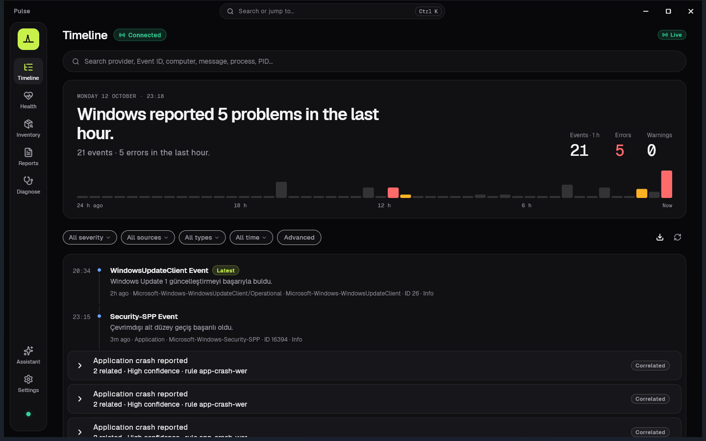
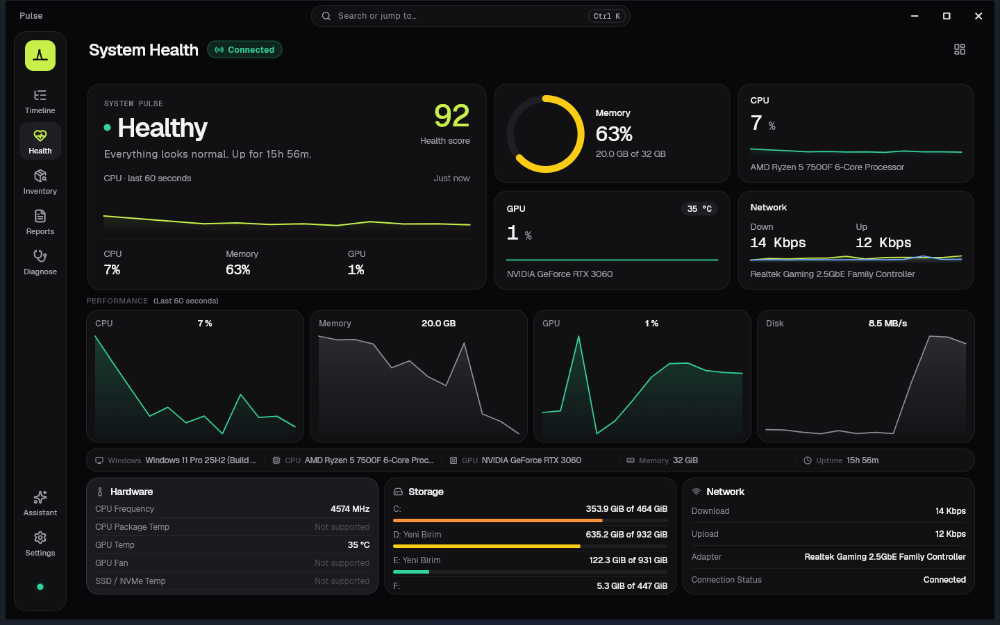
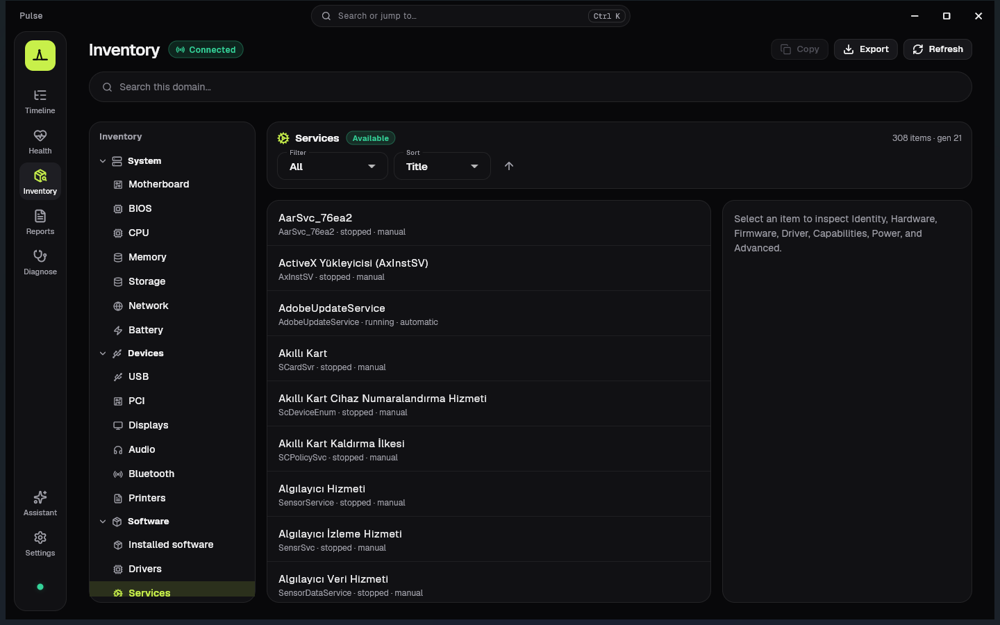
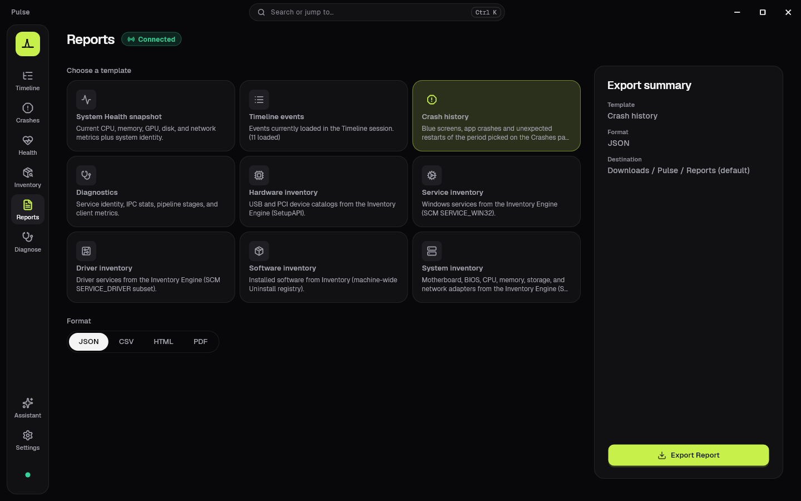
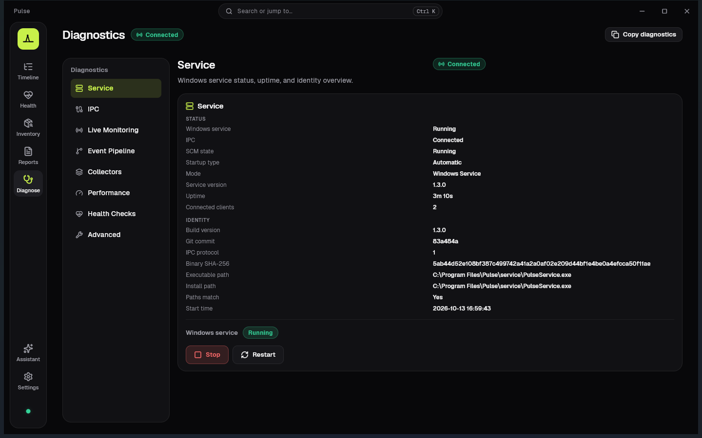

<p align="center">
  
</p>

<h1 align="center">Pulse</h1>

<p align="center">
  <strong>See what Windows is really doing.</strong><br />
  A read-only Windows diagnostics app that turns the Event Log into plain language.<br />
  Fully offline. No telemetry, no account — nothing leaves your PC.
</p>

<p align="center">
  <a href="https://github.com/Regncreative/Pulse/releases/latest"></a>
  <a href="https://github.com/Regncreative/Pulse/actions/workflows/ci.yml"></a>
  
  <a href="LICENSE"></a>
  
</p>

<p align="center">
  <a href="https://github.com/Regncreative/Pulse/releases/latest"><strong>Download for Windows</strong></a>
  ·
  <a href="https://apps.microsoft.com/detail/9PNDTLNTJ82T"><strong>Microsoft Store</strong></a>
  ·
  <a href="https://pulse.regncreative.com"><strong>Website</strong></a>
</p>

<p align="center">
  
</p>

---

## Contents

- [Why Pulse](#why-pulse)
- [What's new in 1.4](#whats-new-in-14)
- [Features](#features)
- [Install](#install)
- [Privacy and security](#privacy-and-security)
- [How it works](#how-it-works)
- [Build from source](#build-from-source)
- [Roadmap](#roadmap)
- [In the press](#in-the-press)
- [Documentation](#documentation)
- [How Pulse is built](#how-pulse-is-built)
- [Code signing policy](#code-signing-policy)
- [Contributing](#contributing) · [License](#license)

---

## Why Pulse

Windows already records almost everything that happens: crashes, failed services, driver problems, unexpected restarts. It just writes it down as Event IDs and XML.

| Event Viewer shows | Pulse says |
|---|---|
| Application Error · Event ID 1000 | Explorer unexpectedly closed. Windows restarted Explorer. |
| Kernel-Power · Event ID 41, BugcheckCode 159 | Windows restarted after a blue screen. Stop code: DRIVER_POWER_STATE_FAILURE. |
| Kernel-Power · Event ID 41, all values 0 | PC lost power or stopped suddenly — check the power supply, temperatures and overclocking. |
| Service Control Manager · Event ID 7031 | A Windows service crashed and Windows scheduled a recovery action. |

Pulse **observes, explains and visualizes**. It never changes Windows: no injection, no hooks, no patches, no cleaner or optimizer features.

### Pulse, Event Viewer and Reliability Monitor

Windows ships two tools for this. Pulse does not replace them; it sits between them.

| | Event Viewer | Reliability Monitor | Pulse |
|---|---|---|---|
| Language | Event IDs and XML | Short problem titles | Plain sentences first; technical detail and raw XML on demand |
| Coverage | Every log | Crashes, failed updates, installs | Curated Event Log events, live |
| Live view | Manual refresh | Daily history | Live timeline and System Health |
| Hardware and processes | — | — | CPU, memory, GPU, disk and network, per process |
| Related events | Separate rows | Grouped by day | Correlated incidents |
| Built for | Administrators | A quick crash history | Curious users and IT support |

---

## What's new in 1.5

- **Every GPU.** PCs with an integrated and a dedicated GPU see both in System Health, each with its load and memory. GPU load is now worked out the way Task Manager does it.
- **Hide events you expect.** "Hide events like this" takes an event type out of the Timeline and its counts. A counter shows how many are hidden, Settings brings them back, and reports and exports still contain every event.
- **One Pulse at a time.** Starting Pulse again brings the running window forward, even from the tray.

Full notes: [v1.5.0](docs/releases/v1.5.0.md) · [CHANGELOG](CHANGELOG.md)

## What's new in 1.4

**1.4.3**: no more crash on exit, Markdown and Enter-to-send in the Assistant, a custom date range in the Timeline, and a clean uninstall.

**1.4.2**: the Disk panel totals every drive and shows the system disk's details again.

**1.4.1**

- **Health for every disk**: temperature and SMART for each disk, and for NVMe drives wear, spare capacity, power-on time, unsafe shutdowns and media errors.
- **What woke the PC**: the device or scheduled task behind a wake from sleep.
- **Secure Boot events explained**, including the SBAT update failure.
- **A deeper Assistant**: command lines, CPU time, private bytes and Windows services; port and API key settings. It still talks only to a local AI on this PC.

**1.4.0**

- **Blue screens and sudden restarts, explained.** Kernel-Power 41 and bug check 1001 are read from their event data: the stop code name, what usually causes it and what to check next. Pulse also tells a forced power-off, a power loss and WHEA hardware errors apart, and groups a blue screen with its restart.
- **Open an `.evtx` from another PC.** Export the event log on the PC you are helping and read it in Pulse the same way — even while PulseService is offline.
- **Reports you can share.** Exports mask user and computer names, profile paths, account SIDs, IP and MAC addresses and serial numbers by default.
- **Update notice** for the GitHub edition (manual or weekly, off by default).

Full notes: [v1.4.3](docs/releases/v1.4.3.md) · [v1.4.2](docs/releases/v1.4.2.md) · [v1.4.1](docs/releases/v1.4.1.md) · [v1.4.0](docs/releases/v1.4.0.md) · [CHANGELOG](CHANGELOG.md)

---

## Features

**Timeline**
- Live Windows Event Log feed in plain language, newest first, with a one-sentence summary of the last hour and a 24-hour activity strip
- Explained · Technical · Raw XML views for every event
- Correlated incidents (app crash and its error report, blue screen and restart, service crash and recovery)
- Search and filters by severity, source, category, provider, Event ID, process and time; saved searches, bookmarks and pins
- Open exported `.evtx` files; export the view as JSON or CSV

**System Health**
- Health score, CPU (frequency-aware, matches Task Manager), memory, GPU, disk and network, with 60-second history
- Per-process CPU, memory and network
- Optional background alerts for sustained high CPU or memory, from the system tray

**Inventory**
- System: motherboard, BIOS, CPU, memory modules, storage, network adapters, battery
- Devices: USB, PCI, displays, audio, Bluetooth, printers
- Software: installed programs, drivers and Windows services

**Reports and diagnostics**
- Health, Timeline, Diagnostics and inventory reports as JSON, CSV, HTML or PDF, saved locally
- Service and IPC diagnostics with a support bundle you can attach to an issue

**Assistant (optional)**
- Ask about this PC in plain language using a model you run yourself in **Ollama** or **LM Studio**
- Localhost only, read-only tools; it cannot run commands or change settings

**App**
- Dark-first Midnight design, Ctrl+K command search, custom title bar, DPI aware
- Settings for appearance, background mode, System Health, Timeline, diagnostics, performance, privacy and updates; all stored locally

<p align="center">
  
  
</p>
<p align="center">
  
  
</p>

---

## Install

**Requirements:** Windows 10 or 11, 64-bit (x64). The Microsoft Store edition needs Windows 10 version 2004 or later. Installing the background service needs administrator approval (one UAC prompt).

### GitHub release

1. Download `Pulse-Setup-<version>-windows-x64.exe` from the [latest release](https://github.com/Regncreative/Pulse/releases/latest).
2. Run it and accept the UAC prompt. Setup installs the VC++ runtime if needed, registers PulseService and starts it.
3. Open Pulse from the Start menu.

The release also has a payload ZIP. It still needs PulseService and is not a portable edition (see [portable vs service](docs/architecture/40-portable-vs-service.md)).

### Microsoft Store

[Pulse Diagnostics on the Microsoft Store](https://apps.microsoft.com/detail/9PNDTLNTJ82T) — the service is packaged with the app and updates come through the Store.

### Verify your download

Each release lists SHA-256 checksums in `SHA256SUMS.txt`:

```powershell
Get-FileHash .\Pulse-Setup-1.5.0-windows-x64.exe -Algorithm SHA256
```

Releases are not code-signed yet (see [Code signing policy](#code-signing-policy)), so SmartScreen or some antivirus tools may warn about a new file. More help: [installation guide](docs/guides/installation.md) · [troubleshooting](docs/guides/troubleshooting.md) · [upgrade notes](docs/guides/upgrade-notes.md)

---

## Privacy and security

- **Read-only.** Pulse reads Windows data through official APIs and never changes the system.
- **Nothing leaves your PC.** No telemetry, analytics, crash reporting, account or cloud.
- **Network use is opt-in:** the Assistant talks only to `localhost`; the update check (GitHub edition) contacts GitHub only when you click *Check* or turn on weekly checks.
- **Low privilege.** PulseService runs as `LocalService`, not SYSTEM, and talks to the app over a local named pipe that is not reachable from the network.
- **Shareable exports.** Personal details are masked in reports and exports by default.

Details: [security guide](docs/guides/security.md) · [SECURITY.md](SECURITY.md) (reporting vulnerabilities) · [privacy policy](https://pulse.regncreative.com/privacy)

---

## How it works

```
┌──────────────────────────────────────────────────────────────┐
│                           Windows                            │
│ Event Log · PDH · DXGI · IP Helper · ETW (network) · SetupAPI│
└──────────────────────────────┬───────────────────────────────┘
                               │ read-only APIs
┌──────────────────────────────▼───────────────────────────────┐
│               PulseService (C++20, LocalService)             │
│     Collectors · crash explainer · humanizer · health ·      │
│     inventory · IPC server                                   │
└──────────────────────────────┬───────────────────────────────┘
                               │ local named pipe (framed binary protocol)
┌──────────────────────────────▼───────────────────────────────┐
│                     Pulse app (Flutter)                      │
│   Timeline · System Health · Inventory · Reports · Assistant │
└──────────────────────────────────────────────────────────────┘
```

- **PulseService** collects and explains events. Event Log entries are read with `EvtQuery` / `EvtSubscribe`; per-process network uses a Pulse-owned ETW session ([ADR-009](docs/architecture/decisions/ADR-009-health-network-etw.md)).
- **Pulse app** renders the UI. Exported `.evtx` files are read by `PulseService.exe --read-evtx`, run as the signed-in user ([ADR-014](docs/architecture/decisions/ADR-014-open-exported-evtx.md)).
- Kernel-level activity in the Timeline is planned through ETW, never a driver ([ADR-015](docs/architecture/decisions/ADR-015-kernel-activity-via-etw.md), proposed).

Architecture and decisions: [docs/architecture](docs/architecture/README.md)

---

## Build from source

Prerequisites: Visual Studio 2022+ Build Tools with C++ (CMake and Ninja), Flutter (stable), and [Inno Setup 6](https://jrsoftware.org/isinfo.php) for the installer.

```powershell
# Service in console mode (no installation needed)
.\tools\scripts\run_service_console.ps1

# App, in a second terminal
.\tools\scripts\run_app.ps1

# Tests
ctest --test-dir build/service
cd apps\pulse_app; flutter analyze; flutter test

# Release installer and ZIP into dist\
.\tools\scripts\package_beta.ps1
```

Releases are built by [`.github/workflows/release.yml`](.github/workflows/release.yml); a `vX.Y.Z` tag creates a draft release with checksums. Details: [BUILD.md](BUILD.md) · [DEVELOPMENT.md](DEVELOPMENT.md)

**Repository layout**

| Path | Contents |
|---|---|
| `apps/pulse_app/` | Flutter desktop app and its tests (`test/`) |
| `service/pulse_service/` | Native Windows service and its tests (`test/`) |
| `shared/` | Wire protocol (C++ and Dart) and shared constants |
| `tools/` | Installer, packaging and dev scripts, IPC ping tools, branding generators |
| `docs/` | Architecture, ADRs, guides and release notes |

---

## Roadmap

- [x] Event Log → human-readable Timeline, live monitoring
- [x] System Health, Inventory, Reports, Diagnostics
- [x] Local Assistant (Ollama / LM Studio), Microsoft Store edition — 1.1
- [x] Midnight redesign — 1.2
- [x] Stability release, ~100 MB smaller — 1.3
- [x] Crash explainer, `.evtx` import, masked exports, update notice — 1.4
- [ ] Code-signed releases (SignPath Foundation, in review)
- [ ] Process lifecycle in the Timeline via ETW ([ADR-015](docs/architecture/decisions/ADR-015-kernel-activity-via-etw.md))
- [ ] Minidump analysis for blue screens
- [ ] Portable edition (postponed; see [40](docs/architecture/40-portable-vs-service.md))
- [ ] Plugin system, session recording and timeline replay

Every feature should answer one question: **"What is Windows doing right now?"**

---

## In the press

- **TecnoAndroid** (Italy, 18 October 2026) — [*Pulse per Windows 11: il Visualizzatore eventi diventa leggibile*](https://www.tecnoandroid.it/news/pulse-per-windows-11-il-visualizzatore-eventi-diventa-leggibile-1994644/) by Manuel De Pandis. PulseMCP mentioned there was removed in 1.3; the Assistant talks only to a local AI on this PC.
- **IlSoftware.it** (Italy, 13 October 2026) — [*Visualizzatore eventi Windows 11 più comprensibile con un tool open source*](https://www.ilsoftware.it/focus/visualizzatore-eventi-windows-11-migliorato-pulse/) by Michele Nasi. The article covers Pulse 1.2; AI Integration (MCP) mentioned there was replaced by the local Assistant in 1.3.

---

## Documentation

| Document | Purpose |
|---|---|
| [AGENTS.md](AGENTS.md) | Product principles and development rules |
| [docs/architecture](docs/architecture/README.md) | Architecture package and ADRs |
| [docs/guides](docs/guides/installation.md) | Installation, troubleshooting, upgrade notes, security |
| [docs/releases](docs/releases/v1.5.0.md) | Release notes |
| [CHANGELOG.md](CHANGELOG.md) | Version history |
| [BUILD.md](BUILD.md) · [DEVELOPMENT.md](DEVELOPMENT.md) | Building and local workflow |
| [CONTRIBUTING.md](CONTRIBUTING.md) · [SECURITY.md](SECURITY.md) | Contributing and vulnerability reports |

---

## How Pulse is built

Pulse is built by one developer with the help of AI coding assistants. [AGENTS.md](AGENTS.md) is the instruction file those assistants follow; it is also the product's rulebook (read-only, local-first, official Windows APIs only).

- I decide what Pulse does, how it looks and what ships.
- Every change goes through tests and CI; every release is installed and tested on real machines before it is published.
- The full source is here, under the MIT license, so anyone can review exactly what Pulse runs.

Bug reports and code review are very welcome — open an issue.

---

## Code signing policy

Windows releases of Pulse are being moved to signing through the SignPath Foundation's free program for open-source projects (application in review):

Free code signing provided by [SignPath.io](https://about.signpath.io/), certificate by [SignPath Foundation](https://signpath.org/).

- **Committers and reviewers:** [Regncreative](https://github.com/Regncreative) (maintainer)
- **Approvers:** [Regncreative](https://github.com/Regncreative)
- Only release builds produced by this repository's GitHub Actions workflow are signed. Every signing request is approved manually.
- The Microsoft Store edition is signed by Microsoft.

**Privacy:** This program will not transfer any information to other networked systems unless specifically requested by the user or the person installing or operating it. The optional Assistant only talks to an AI runtime on `localhost`; the optional update check contacts GitHub only when you ask it to. See the [privacy policy](https://pulse.regncreative.com/privacy).

---

## Contributing

Issues and pull requests are welcome. Please read [AGENTS.md](AGENTS.md) and [CONTRIBUTING.md](CONTRIBUTING.md) first:

1. Keep changes observation-only — no cleaner, optimizer or antivirus features.
2. Run `ctest` and `flutter analyze` / `flutter test` before opening a pull request.
3. Architectural changes need an ADR under `docs/architecture/decisions/`.

## License

[MIT](LICENSE) © [Regncreative](https://github.com/Regncreative)
