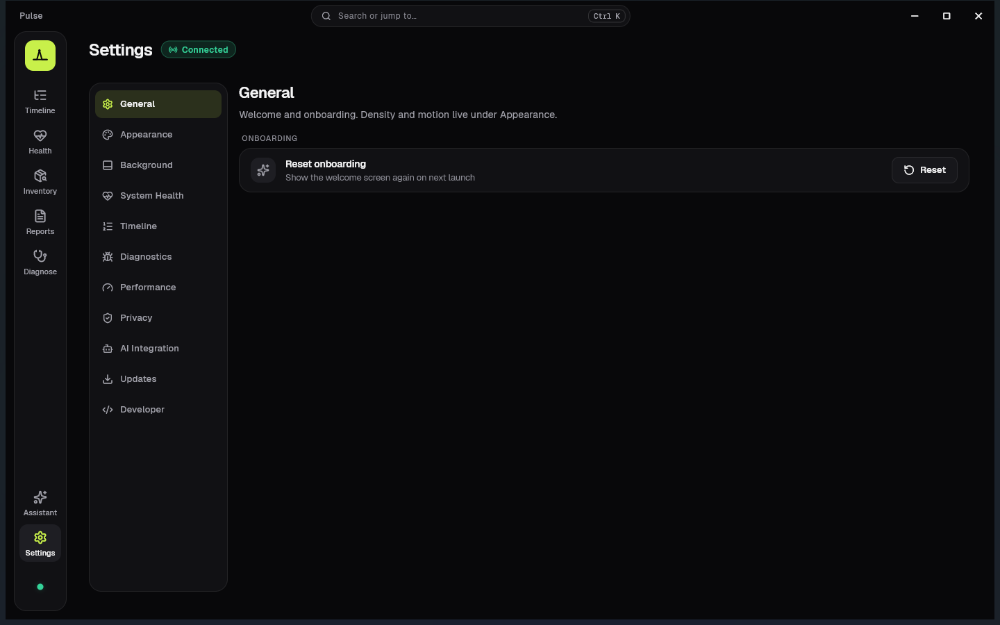

<p align="center">
  
</p>

<h1 align="center">Pulse</h1>

<p align="center">
  <strong>See what Windows is really doing.</strong><br />
  A modern, read-only diagnostics platform for Windows — events you can understand, not logs you decode.<br />
  <strong>Fully offline. Read-only. No telemetry, no account — nothing leaves your PC.</strong>
</p>

<p align="center">
  <a href="https://github.com/Regncreative/Pulse">github.com/Regncreative/Pulse</a>
</p>

<p align="center">
  
  
  
  
  
  
  
  <a href="https://www.virustotal.com/gui/file/7311a4809e64f77b9c44dc8fd59d04db68e3f07288e2348b6470807be72c41d3"></a>
</p>

<p align="center">
  
</p>

<p align="center"><em>Timeline — live Event Log events in plain language</em></p>

---

## What is Pulse?

Windows already knows everything about itself — crashes, service starts, explorer restarts, boot failures. The problem is how that knowledge is presented: Event Viewer IDs, opaque XML, and tools that feel like they were built for another decade.

**Pulse observes. Pulse explains. Pulse visualizes. Pulse never changes Windows.**

It turns raw system activity into a readable timeline:

| Instead of… | Pulse shows… |
|---|---|
| Application Error · Event ID 1000 | Explorer unexpectedly closed. Windows restarted Explorer. |
| Service Control Manager · 7036 | Windows Update service entered the running state. |
| Kernel-Power · 41 | The system restarted without a clean shutdown. |

Designed in **Midnight**, Pulse's dark-first visual identity: near-black panels, one lime accent for what is live, and plain language before technical detail.

> **Philosophy:** Observation only. No injection. No hooks. No patches. No telemetry. No cloud.

### Pulse, Event Viewer and Reliability Monitor

Windows already ships two tools for this. Pulse does not replace them; it sits between them.

| | Event Viewer | Reliability Monitor | Pulse |
|---|---|---|---|
| Language | Event IDs and XML | Short problem titles | Plain sentences first, technical detail and raw XML on demand |
| Coverage | Every log | Crashes, failed updates, installs | Curated Event Log events, live |
| Live view | Manual refresh | Daily history | Live timeline and System Health |
| Hardware and processes | — | — | CPU, memory, GPU, disk, network per process |
| Related events | Separate rows | Grouped by day | Correlated incidents |
| Built for | Administrators | Quick crash history | Curious users and IT support |

Reliability Monitor is great for a quick look at what failed this week. Event Viewer has everything, if you can read it. Pulse explains what happened, while it happens.

---

## Features

### Timeline
- **Plain-language summary** — the last hour in one sentence, with a 24-hour activity strip
- **Human-readable events** — story feed with plain language first; Explained / Technical / Raw XML tabs in the inspector
- **Live monitoring** — Windows Event Log via `EvtSubscribe`, pushed over named-pipe IPC
- **Historical snapshot** — recent events on connect, then live prepend as Windows works
- **Search & filters** — severity, source, category, provider, process, and date presets (including last 15 minutes)
- **Detail panel** — metadata, process context, and expandable raw event payload
- **Incidents & export** — correlated groups plus JSON/CSV export of the session

### System Health
- **Overview bento** — system pulse with health score, memory ring, CPU, GPU and network tiles
- **CPU, Memory, GPU, Disk, Network** — live cards and 60-second sparklines
- **PDH Processor Utility** — frequency-aware CPU % (not just classic Processor Time)
- **Hardware summary** — OS, CPU, GPU, memory, uptime at a glance
- **Graceful offline mode** — clear empty states when PulseService is not running

### Inventory
- **System** — motherboard, BIOS, CPU, memory, storage, network, battery (SMBIOS / SetupAPI where available)
- **Devices** — USB, PCI, displays, audio, Bluetooth, printers
- **Software** — installed programs, drivers, and Windows services
- **Copy & export** — field-level copy plus inventory reports

### Reports
- **Templates** — System Health, Timeline, Diagnostics, and inventory catalogs
- **Formats** — JSON, CSV, HTML, PDF
- **Local export** — writes under Documents / Pulse / exports by default

### Diagnostics
- **Service snapshot** — SCM state, uptime, identity, binary path, connected clients
- **IPC & pipeline** — named-pipe health, collectors, performance budgets
- **Copy diagnostics** — support bundle without leaving the machine

### Settings
- General, Appearance, System Health, Timeline, Diagnostics, Performance, Privacy
- Preferences persist locally (`SharedPreferences`) — no account, no sync

### Product principles
- **Read-only** — never modifies OS behavior
- **Local-first** — everything stays on this PC
- **No telemetry / analytics / ads**
- **Fast & light** — idle near-zero CPU, responsive scrolling
- **Native Windows feel** — custom title bar, icon rail, Ctrl+K command search, DPI-aware

---

## Screenshots

<p align="center">
  
  &nbsp;
  
</p>

<p align="center">
  <strong>Timeline</strong> — live humanized events &nbsp;·&nbsp;
  <strong>System Health</strong> — CPU, memory, GPU, disk, network
</p>

<p align="center">
  
  &nbsp;
  
</p>

<p align="center">
  <strong>Inventory</strong> — hardware & software catalog &nbsp;·&nbsp;
  <strong>Reports</strong> — local JSON / CSV / HTML / PDF export
</p>

<p align="center">
  
  &nbsp;
  
</p>

<p align="center">
  <strong>Diagnostics</strong> — service, IPC, pipeline &nbsp;·&nbsp;
  <strong>Settings</strong> — local preferences
</p>

---

## Architecture

```
┌──────────────────────────────────────────────────────────┐
│                         Windows                          │
│   Event Log · PDH · DXGI · IP Helper · Process APIs      │
└────────────────────────────┬─────────────────────────────┘
                             │ read-only APIs
┌────────────────────────────▼─────────────────────────────┐
│                      PulseService                        │
│  Collector · Humanizer · Health · Inventory · IPC server │
│              (native C++ Windows service)                │
└────────────────────────────┬─────────────────────────────┘
                             │ named pipe (framed binary)
┌────────────────────────────▼─────────────────────────────┐
│                       Pulse App                          │
│   Flutter · Timeline · Health · Inventory · Reports      │
└──────────────────────────────────────────────────────────┘
```

**v1 pipeline**

```
Windows Event Log → Collector → Humanizer → IPC → Timeline UI
```

PulseService is required (installer or elevated `--install-start`). A ZIP payload is not a true portable edition — see [portable vs service](docs/architecture/40-portable-vs-service.md).

ETW, WMI, and plugins are intentional future milestones — see [docs/architecture](docs/architecture/README.md).

---

## Installation

### For everyone (stable installer)

1. Download **`Pulse-Setup-1.3.0-windows-x64.exe`** from [GitHub Releases](https://github.com/Regncreative/Pulse/releases/tag/v1.3.0)
2. Run the installer and accept the UAC prompt
3. PulseService is registered and started automatically
4. Skip or complete the short welcome — then open Timeline or System Health

Tip: for troubleshooting without the SCM service, run `service\PulseService.exe --console` from a payload folder.

### VirusTotal

`Pulse-Setup-1.0.0-windows-x64.exe` was scanned on [VirusTotal](https://www.virustotal.com/gui/file/7311a4809e64f77b9c44dc8fd59d04db68e3f07288e2348b6470807be72c41d3) — **0 / 68** security vendors flagged the installer. Clean result across the board.

<p align="center">
  <a href="https://www.virustotal.com/gui/file/7311a4809e64f77b9c44dc8fd59d04db68e3f07288e2348b6470807be72c41d3">
    
  </a>
</p>

<p align="center">
  <em>SHA-256:</em>
  <code>7311a4809e64f77b9c44dc8fd59d04db68e3f07288e2348b6470807be72c41d3</code>
</p>

Developers can also build a local package:

```powershell
.\tools\scripts\package_beta.ps1
```

Output: `dist\Pulse-Setup-1.3.0-windows-x64.exe`, `dist\Pulse\`, and `dist\Pulse-1.3.0-windows-x64.zip`

### For developers (day-to-day)

```powershell
# 1) Build & run the service (console mode — preferred while developing)
.\tools\scripts\run_service_console.ps1

# 2) In another terminal — run the Flutter app
.\tools\scripts\run_app.ps1
```

Or step by step:

```powershell
# Service
cmake -S service/pulse_service -B build/service -G Ninja -DCMAKE_BUILD_TYPE=Debug
cmake --build build/service
.\build\service\PulseService.exe --console

# App
cd apps\pulse_app
flutter pub get
flutter run -d windows
```

Optional SCM install (elevated):

```powershell
.\build\service\PulseService.exe --install
Start-Service PulseService
```

Full prerequisites and flags: [BUILD.md](BUILD.md) · [DEVELOPMENT.md](DEVELOPMENT.md)

---

## Local AI Assistant

Ask about this PC in plain language. The **Assistant** talks to a local model you run yourself — **Ollama** or **LM Studio** — and answers from Pulse's read-only diagnostics.

- Localhost only: Pulse refuses non-local AI endpoints, so diagnostics never leave the PC
- Read-only tools: the Assistant cannot run commands, change settings or modify Windows
- Pulse never downloads models or installs AI software for you

AI Integration for external MCP clients (PulseMCP) was removed in 1.3 — see [ADR-013](docs/architecture/decisions/ADR-013-remove-pulsemcp.md).

Guides: [Installation](docs/guides/installation.md) · [Troubleshooting](docs/guides/troubleshooting.md) · [Security](docs/guides/security.md)

---

## Development

| Command | Description |
|---|---|
| `.\tools\scripts\run_service_console.ps1` | Build (if needed) + run PulseService in console |
| `.\tools\scripts\run_app.ps1` | `flutter run -d windows` |
| `cmake --build build/service` | Rebuild native service |
| `.\build\service\pulse_wire_tests.exe` | Wire codec unit tests |
| `.\tools\scripts\run_ipc_ping.ps1` | IPC Ping/Pong smoke |
| `.\tools\scripts\run_diagnostics_ping.ps1` | Diagnostics + inject-event smoke |
| `.\tools\scripts\package_beta.ps1` | Build release installer + payload (`dist\`) |
| `cd apps\pulse_app; flutter test` | Flutter unit / widget tests |

---

## Tech stack

| Layer | Stack |
|---|---|
| **UI** | Flutter Desktop · Provider · window_manager · Geist / Geist Mono · Lucide icons |
| **Service** | C++20 · CMake · Win32 · Wevtapi · PDH · DXGI · IP Helper · SetupAPI / SMBIOS |
| **IPC** | Named pipes · framed binary protocol (`pulse_wire`) · shared Dart/C++ codec |
| **Protocol** | `shared/pulse_protocol` (C++ + Dart) |
| **AI** | Local Assistant — Ollama / LM Studio over localhost, read-only tools via IPC |
| **Persistence (app)** | SharedPreferences for settings · local reports & diagnostics export |
| **CI** | GitHub Actions — Windows service build/tests + Flutter analyze/test |

---

## Project structure

```
Pulse/
├── apps/pulse_app/          Flutter Desktop UI (Timeline, Health, Inventory, Reports, …)
├── service/pulse_service/   Native Windows service (collector, humanizer, health, IPC)
├── shared/
│   ├── pulse_common/        Version, errors, constants
│   └── pulse_protocol/      Wire codec (C++ + Dart) + proto
├── tools/
│   ├── ipc_ping/            Smoke clients (IPC / health / diagnostics)
│   └── scripts/             Dev launch + packaging helpers
├── docs/architecture/       ADRs + system design (source of truth)
├── docs/readme/             README screenshots
├── branding/                Logo source (Telemetry Peak)
├── tests/                   Fixtures / integration (expanding)
├── AGENTS.md                Product constitution
└── BUILD.md                 Build & install instructions
```

---

## Roadmap

- [x] Named-pipe IPC + framed wire protocol
- [x] Event Log collector → humanized Timeline
- [x] Live monitoring with page-visibility pause
- [x] System Health (Task Manager–aligned metrics)
- [x] Inventory (system, devices, software)
- [x] Reports (JSON / CSV / HTML / PDF)
- [x] Diagnostics page + local export
- [x] Settings persistence
- [x] Fluent dark-first UI polish
- [x] Official screenshots in README
- [x] First-launch welcome (skippable)
- [x] Timeline search, filters, date presets, session export
- [x] Stable installer (`package_beta.ps1` → Inno Setup)
- [x] **v1.0.0** stable release
- [x] **v1.1.0** feature release (Assistant, Store MSIX)
- [x] **v1.2.0** Midnight redesign (icon rail, story Timeline, Overview bento)
- [x] **v1.3.0** Stability release (service-restart crash, pipe leaks, ~140 MB smaller install; AI Integration removed)
- [ ] Blue screen and sudden-restart explainer (stop codes, hardware errors, power loss)
- [ ] Open `.evtx` files exported from another PC
- [ ] Mask user names and paths in exported reports
- [ ] GitHub Releases update notice
- [ ] Crash / WER timeline
- [ ] ETW engine (future milestone)
- [ ] Plugin system (future milestone)
- [ ] Session recording / timeline replay

Every feature should answer one question: **"What is Windows doing right now?"**

---

## Privacy & security

- **No cloud, no login, no account**
- **No telemetry, analytics, or tracking**
- Data never leaves the machine unless **you** export a report or diagnostics zip
- Uses **official Windows APIs** only
- Never injects into processes, never hooks, never bypasses security
- Elevation only when **you** explicitly install the service

<p align="center">
  <a href="https://www.virustotal.com/gui/file/7311a4809e64f77b9c44dc8fd59d04db68e3f07288e2348b6470807be72c41d3">
    
  </a>
</p>

<p align="center"><em><a href="https://www.virustotal.com/gui/file/7311a4809e64f77b9c44dc8fd59d04db68e3f07288e2348b6470807be72c41d3">VirusTotal</a> — <code>Pulse-Setup-1.0.0-windows-x64.exe</code> · 0/68</em></p>

---

## How Pulse is built

Pulse is built by one developer with the help of AI coding assistants. [AGENTS.md](AGENTS.md) is the instruction file those assistants follow; it is also the product's rulebook (read-only, local-first, official Windows APIs only).

- I decide what Pulse does, how it looks and what ships.
- Every change goes through tests and CI; every release is installed and tested on real machines before it is published.
- The full source is here, under the MIT license, so anyone can review exactly what Pulse runs.

Bug reports and code review are very welcome — open an issue.

---

## Code signing policy

Windows releases of Pulse are being moved to signing through the SignPath Foundation's free program for open-source projects (application in review):

Free code signing provided by [SignPath.io](https://about.signpath.io/), certificate by [SignPath Foundation](https://signpath.org/).

- **Committers and reviewers:** [Regncreative](https://github.com/Regncreative) (maintainer)
- **Approvers:** [Regncreative](https://github.com/Regncreative)
- Only release builds produced by this repository's GitHub Actions workflow are signed. Every signing request is approved manually.
- The Microsoft Store edition is signed by Microsoft.

**Privacy:** This program will not transfer any information to other networked systems unless specifically requested by the user or the person installing or operating it. The optional Assistant only talks to an AI runtime on `localhost`. See the [privacy policy](https://pulse.regncreative.com/privacy).

---

## Documentation

| Doc | Purpose |
|---|---|
| [AGENTS.md](AGENTS.md) | Product vision, principles, AI / development rules |
| [CHANGELOG.md](CHANGELOG.md) | Release history |
| [docs/releases/v1.3.0.md](docs/releases/v1.3.0.md) | v1.3.0 release notes (stability) |
| [docs/releases/v1.2.0.md](docs/releases/v1.2.0.md) | v1.2.0 release notes (Midnight) |
| [docs/releases/v1.1.0.md](docs/releases/v1.1.0.md) | v1.1.0 release notes |
| [docs/releases/v1.0.0.md](docs/releases/v1.0.0.md) | v1.0.0 release notes |
| [docs/architecture/README.md](docs/architecture/README.md) | Full architecture package + ADRs |
| [docs/architecture/24-health-metrics-task-manager.md](docs/architecture/24-health-metrics-task-manager.md) | Health metrics vs Task Manager |
| [BUILD.md](BUILD.md) | Prerequisites & build |
| [DEVELOPMENT.md](DEVELOPMENT.md) | Local workflow |
| [IMPLEMENTATION_GUIDE.md](IMPLEMENTATION_GUIDE.md) | Implementation notes |
| [CONTRIBUTING.md](CONTRIBUTING.md) | How to contribute |

---

## Contributing

Issues and pull requests are welcome.

1. Read [AGENTS.md](AGENTS.md) and the architecture docs first
2. Fork and create a feature branch
3. Keep changes observation-only — no cleaner / optimizer / antivirus features
4. Run `pulse_wire_tests` and `flutter analyze` / `flutter test` before opening a PR
5. Architectural changes need an ADR under `docs/architecture/decisions/`

---

## License

MIT © [Regncreative](https://github.com/Regncreative)
